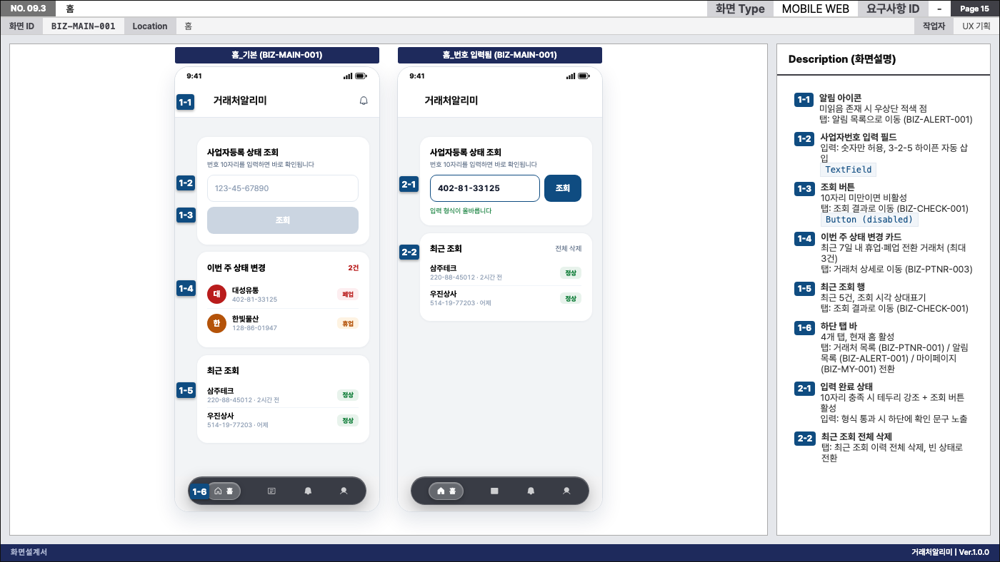
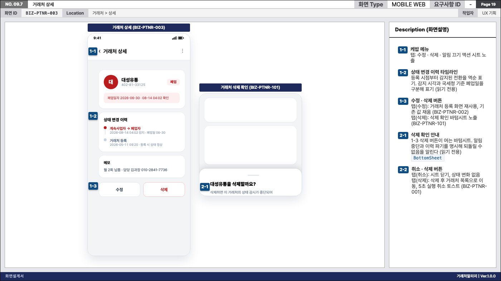
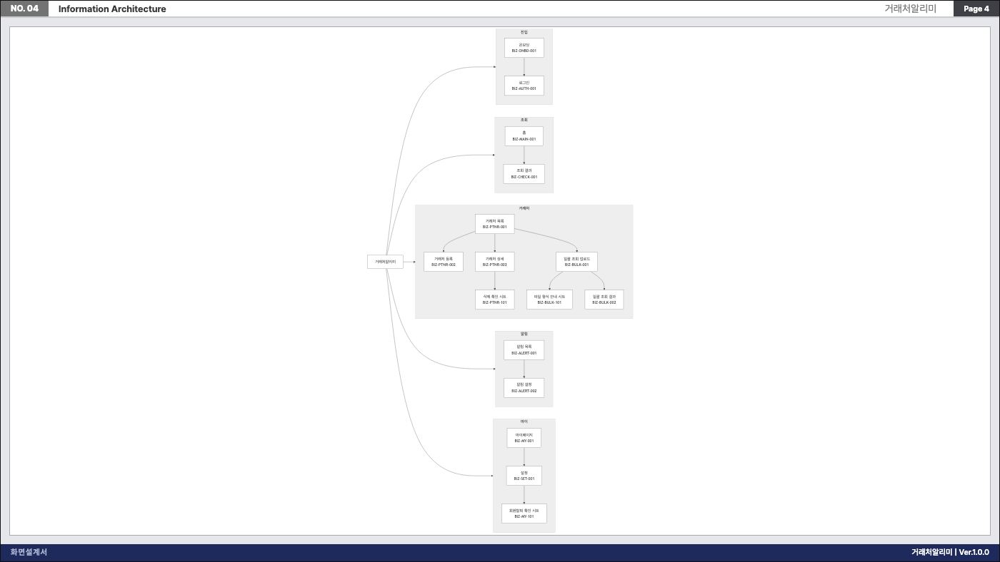
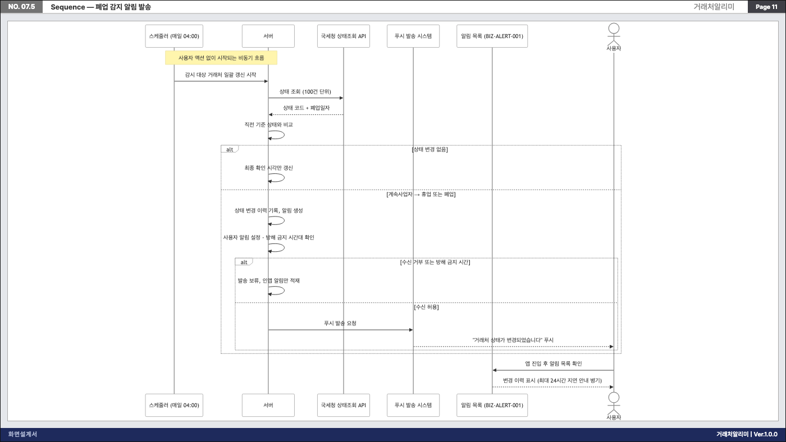
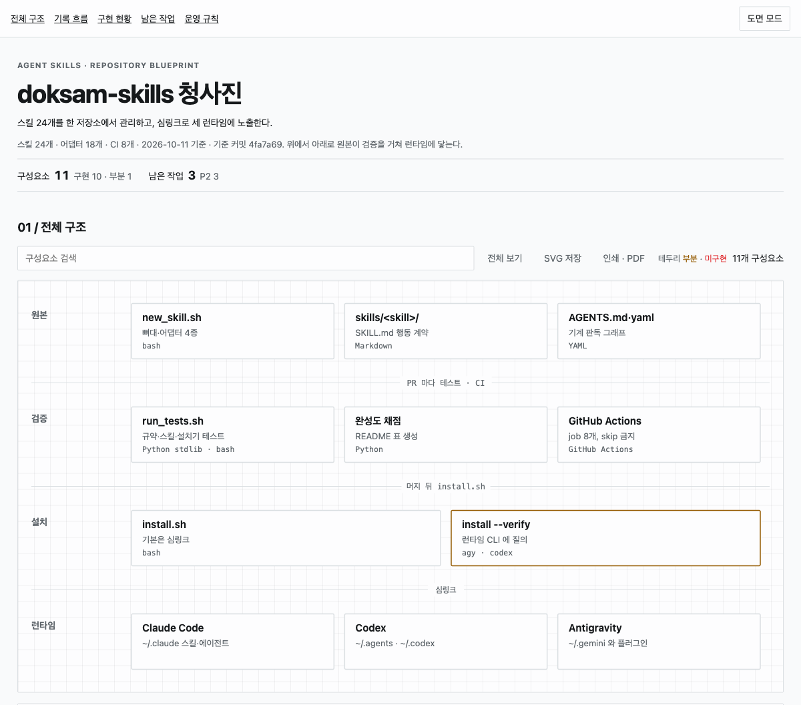

# doksam-skills

Claude Code·Codex·Antigravity 에서 쓰는 Agent Skill 25개입니다. 한국어로 쓰고, 문서의 단언마다 테스트를 붙여 둡니다.



_`yd-mobile-web-planner` 가 한 줄 요청으로 만든 화면설계서의 한 장입니다. 왼쪽 목업과 오른쪽 설명의 번호 배지가 1:1 로 대응합니다. [더 보기](#대표-산출물-화면설계서)_

## 빠르게 시작

[skills.sh](https://skills.sh/leeyudok/doksam-skills) 의 `skills` CLI 로 설치합니다.

```bash
npx skills add leeyudok/doksam-skills
```

저장소를 고치며 쓰려면 클론해서 `install.sh` 로 설치합니다. 기본이 심링크라 `SKILL.md` 를 고치면 세 런타임에 바로 반영됩니다.

```bash
git clone https://github.com/leeyudok/doksam-skills.git
cd doksam-skills
./install.sh              # 스킬만
./install.sh --with-agent # 이름 있는 에이전트까지
```

설치한 뒤에는 하고 싶은 일을 그대로 요청합니다. 요청 문장이 스킬 설명과 맞으면 런타임이 스킬을 고릅니다.

> *"반려동물 용품 쇼핑몰 모바일웹 화면설계서 만들어줘"*
> *"이 레포 청사진 띄워줘"*
> *"이 PR 본문 번역투 빼고 다듬어줘"*

## 스킬

스킬은 26개입니다. 이름을 직접 부를 필요는 없습니다. `yd-` 는 저장소 소유자가 만든 스킬이라는 표시입니다.

`에이전트` 열은 그 스킬을 이름 있는 에이전트로도 부를 수 있는지 보여줍니다. 터미널에서는 `./install.sh --list` 로 같은 내용과 런타임별 설치 상태를 봅니다.

### 기획에서 구현까지

| 스킬 | 에이전트 (Claude / Codex) | 언제 쓰나 |
|---|---|---|
| [yd-sdlc-orchestrator](skills/yd-sdlc-orchestrator/SKILL.md) | `yd-sdlc-orchestrator` / `yd_sdlc_orchestrator` | 한 줄 요청으로 서비스 전체를 만들 때. 기획 → 구현 → 보안 → 로컬 기동을 차례로 맡기고 단계마다 게이트를 확인합니다 |
| [yd-mobile-web-planner](skills/yd-mobile-web-planner/SKILL.md) | `yd-mobile-web-planner` / `yd_mobile_web_planner` | 모바일 웹·앱의 IA 와 화면설계서(HTML 슬라이드)와 Business Rules 를 만들 때 |
| [yd-nextjs-implementer](skills/yd-nextjs-implementer/SKILL.md) | `yd-nextjs-implementer` / `yd_nextjs_implementer` | 화면설계서를 코드로 옮길 때. 프론트는 Next.js 또는 Vite + React 중에서 고릅니다 |
| [yd-finguard](skills/yd-finguard/SKILL.md) | `yd-finguard` / `yd_finguard` | FinGuard CLI 로 취약점을 점검하고, 심각도 기준으로 통과 여부를 가를 때 |

### UI 와 기술 스택

| 스킬 | 에이전트 (Claude / Codex) | 언제 쓰나 |
|---|---|---|
| [yd-blueprint](skills/yd-blueprint/SKILL.md) | `yd-blueprint` / `yd_blueprint` | 프로젝트의 구조·구현 현황·남은 작업을 JSONL 로 적고 bun + Vite + React 청사진 화면으로 띄울 때. 근거 코드 경로가 낡았는지도 검사합니다 |
| [yd-script-editor](skills/yd-script-editor/SKILL.md) | `yd-script-editor` / `yd_script_editor` | 시연·데모 영상 대본을 웹 에디터로 고치고 음성 합성·시각 맞춤·장면 렌더·믹싱을 레포 설정 하나로 돌릴 때. 레포마다 에디터 서버와 공개 터널을 구성합니다 |
| [yd-doksam-ui](skills/yd-doksam-ui/SKILL.md) | `yd-doksam-ui` / `yd_doksam_ui` | doksam 프로젝트 UI 를 ui.doksam.com 표준(토큰·컴포넌트·규칙)에 맞출 때. 표준 카탈로그 자체를 넓힐 때도 씁니다 |
| [yd-frontend-build](skills/yd-frontend-build/SKILL.md) | `yd-frontend-build` / `yd_frontend_build` | pnpm·Vite 빌드, 의존성, 번들 크기, 폐쇄망 self-host 를 다룰 때 |
| [yd-typescript](skills/yd-typescript/SKILL.md) | 없음 | TypeScript 정적 타입과 실행 데이터의 경계, 비동기 UI·DOM 접근을 점검할 때. Bun 브라우저 코드에도 적용합니다 |
| [yd-react-expert](skills/yd-react-expert/SKILL.md) | `yd-react-expert` / `yd_react_expert` | React 19 컴포넌트·상태·effect·접근성·렌더 성능을 다룰 때 |
| [yd-go-expert](skills/yd-go-expert/SKILL.md) | `yd-go-expert` / `yd_go_expert` | Go 1.22+ 코드를 쓰거나 리뷰할 때 (에러·동시성·`net/http`·`go:embed`) |
| [yd-sqlite-expert](skills/yd-sqlite-expert/SKILL.md) | `yd-sqlite-expert` / `yd_sqlite_expert` | SQLite 고유 문제를 다룰 때 (읽기 전용 조회·WAL·잠금·동적 테이블명) |
| [yd-db-expert](skills/yd-db-expert/SKILL.md) | `yd-db-expert` / `yd_db_expert` | 엔진과 무관한 관계형 설계(정규화·키·제약·인덱스 선택·트랜잭션 경계·마이그레이션 단계)를 다룰 때 |
| [yd-pg-expert](skills/yd-pg-expert/SKILL.md) | `yd-pg-expert` / `yd_pg_expert` | PostgreSQL 고유 동작(잠금을 잡는 ALTER·`CONCURRENTLY`·VACUUM·실행계획)과 공유 클러스터 운영을 다룰 때 |
| [yd-oracle-expert](skills/yd-oracle-expert/SKILL.md) | `yd-oracle-expert` / `yd_oracle_expert` | Oracle 고유 문제(빈 문자열 NULL·DATE 시각·VARCHAR2 바이트·ROWNUM·암묵 커밋·SQL*Plus)를 다룰 때 |

### 에이전트 작업 관리

| 스킬 | 에이전트 (Claude / Codex) | 언제 쓰나 |
|---|---|---|
| [yd-handoff](skills/yd-handoff/SKILL.md) | 없음 | 세션을 끊고 다음 세션에 넘길 때. 트래커가 있으면 이슈 본문에 남기고 URL 하나로 넘깁니다. `HANDOFF.md` 는 트래커가 없는 폴더에서만 씁니다 |
| [yd-agents-yaml](skills/yd-agents-yaml/SKILL.md) | 없음 | 저장소에 `AGENTS.md` + `AGENTS.yaml` + 검증기를 세팅하거나 고칠 때 |
| [yd-agents-mem](skills/yd-agents-mem/SKILL.md) | 없음 | 전역 지침·메모리·설정을 고친 뒤 agents-mem 레포에 백업할 때. 다른 호스트 변경을 받거나 새 머신을 복원할 때도 씁니다 |
| [yd-git-ship](skills/yd-git-ship/SKILL.md) | 없음 | doksam GitLab 레포에 에이전트 작업을 올릴 때. 이슈·브랜치·커밋 제목·MR·머지·CI 추적을 정해진 계정과 형식으로 처리합니다 |
| [yd-git-sync](skills/yd-git-sync/SKILL.md) | 없음 | 여러 호스트에 클론한 같은 저장소를 맞출 때. git 은 ff-only 로 당겨 목록 해시로 비교하고, 미추적 폴더는 지우지 않고 합집합으로 채웁니다 |
| [yd-claude-auth-sync](skills/yd-claude-auth-sync/SKILL.md) | 없음 | 한 PC 에서 다시 로그인한 Claude Code 인증을 등록한 다른 호스트에도 맞출 때. 토큰은 ssh 표준입력으로만 넘기고 화면에 내지 않습니다 |
| [yd-skill-evolve](skills/yd-skill-evolve/SKILL.md) | `yd-skill-evolve` / `yd_skill_evolve` | 피드백이나 반복된 실수를 이 저장소 스킬의 `SKILL.md` 에 반영할 때 |
| [yd-memory-factcheck](skills/yd-memory-factcheck/SKILL.md) | `yd-memory-factcheck` / `yd_memory_factcheck` | 에이전트 메모리를 코드·DB·이슈와 대조해 낡은 기억을 고칠 때 |
| [yd-doc-sync](skills/yd-doc-sync/SKILL.md) | `yd-doc-sync` / `yd_doc_sync` | 코드·구성이 바뀐 뒤 지침·README·규칙·docs 에 남은 낡은 참조를 찾아 고칠 때. 지워지거나 옮겨진 경로를 스크립트로 뽑고, 시점 기록은 남기고 현행 지시만 고칩니다 |
| [yd-session-recording](skills/yd-session-recording/SKILL.md) | 없음 | 강의·회의를 실시간 전사하고 10분마다 요약할 때. "녹음시작" 으로 시작합니다 |

### 글쓰기

| 스킬 | 에이전트 (Claude / Codex) | 언제 쓰나 |
|---|---|---|
| [yd-writer-kr](skills/yd-writer-kr/SKILL.md) | `yd-writer-kr` / `yd_writer_kr` | 이슈·PR·문서·공지·보고서를 한국어로 쓰거나 고칠 때. 번역투와 군더더기를 빼고, 주장마다 근거를 붙입니다 |

## 에이전트

스킬 18개는 이름 있는 에이전트로도 부를 수 있습니다. 에이전트는 스킬로 들어가는 입구일 뿐이고, 행동 규칙은 `SKILL.md` 한곳에만 있습니다.

| 런타임 | 에이전트 이름 | 부르는 법 |
|---|---|---|
| Claude Code | 스킬 이름 그대로 | `claude --agent yd-mobile-web-planner "..."` |
| Codex | `-` 를 `_` 로 바꾼 이름 | `yd_mobile_web_planner agent 를 사용해서 ...` |
| Antigravity | 스킬 이름 그대로 (`doksam-skills-agents` 플러그인) | `agy agents` 로 등록 확인 |

에이전트가 **없는** 스킬은 8개입니다. 빠뜨린 것이 아니라 일부러 두지 않았습니다.

| 스킬 | 에이전트를 두지 않는 이유 |
|---|---|
| yd-session-recording | 녹음 프로세스를 몇 시간 띄워 두고 대화 중에 "중간 요약"·"녹음종료" 를 받아야 합니다. 한 번 실행하고 끝나는 에이전트로는 유지할 수 없습니다 |
| yd-handoff | 지금 세션의 상태를 그 자리에서 남기는 절차입니다. 다른 에이전트에게 맡기면 넘길 상태를 모릅니다 |
| yd-agents-yaml | 작업 중인 저장소를 직접 조사해 쓰는 절차입니다. 대화 중에 바로 쓰는 편이 빠릅니다 |
| yd-agents-mem | 지금 세션의 홈 디렉터리를 대상으로 바로 실행하는 절차입니다. 무엇을 고쳤는지 아는 세션이 돌려야 커밋 제목을 제대로 씁니다 |
| yd-git-ship | 지금 세션의 작업을 지금 세션의 계정·모델명으로 올리는 절차입니다. 다른 에이전트에게 맡기면 커밋 작성자와 제목의 모델명이 틀어집니다 |
| yd-git-sync | 지금 세션의 ssh 별칭으로 바로 돌리고, 충돌·중복 파일은 그 자리에서 사용자에게 물어 정해야 합니다. 다른 에이전트에게 맡기면 판단을 넘길 곳이 없습니다 |
| yd-claude-auth-sync | 지금 PC 의 키체인과 ssh 별칭으로 바로 돌립니다. 토큰을 다른 에이전트 컨텍스트로 넘길 이유가 없습니다 |
| yd-typescript | TypeScript 코드를 맡은 구현 에이전트가 바로 적용하는 검토 기준입니다. 별도 에이전트로 나누면 코드 변경 맥락이 끊깁니다 |

어댑터 파일은 각 스킬의 `agents/` 에 있습니다(`claude.md`·`codex.toml`·`antigravity.md`·`openai.yaml`). 등록 여부는 `./install.sh --verify --with-agent` 로 확인합니다. 런타임은 형식이 틀린 어댑터를 오류 없이 무시하므로, 파일이 있다고 등록된 것은 아닙니다.

## 설치 상세

`./install.sh` 는 `skills/` 아래 모든 스킬을 다음 경로에 겁니다. `<skill_>` 은 `-` 를 `_` 로 바꾼 이름입니다.

| 런타임 | 설치 경로 |
|---|---|
| Codex, Gemini CLI | `~/.agents/skills/<skill>` |
| Claude Code | `~/.claude/skills/<skill>` |
| Antigravity (`agy`) | `~/.gemini/config/skills/<skill>` |
| Claude Code 에이전트 (`--with-agent`) | `~/.claude/agents/<skill>.md` |
| Codex 에이전트 (`--with-agent`) | `~/.codex/agents/<skill_>.toml` |
| Antigravity 에이전트 (`--with-agent`) | `agy plugin install` 로 `doksam-skills-agents` 플러그인 등록(복사) |

Antigravity 공식 문서는 CLI 전역 경로를 `~/.gemini/antigravity-cli/skills/` 로 적습니다. 하지만 agy 1.2.16 은 그 경로를 읽지 않습니다(2026-10-05 실측). 그래서 `~/.gemini/config/skills/` 에 겁니다. 근거는 [AGENTS.md](AGENTS.md) 의 "런타임별 발견 경로" 표에 있습니다. Antigravity 에이전트는 복사 설치라서, 어댑터를 고치면 `./install.sh --with-agent` 를 다시 돌립니다.

| 옵션 | 하는 일 |
|---|---|
| `--project <레포>` | 전역 대신 그 레포의 `.claude/skills/`·`.agents/skills/` 에 건다. agy 가 `.git` 기준으로 찾으므로 레포 루트를 넘긴다 |
| `--vendor <레포>` | 레포에 커밋해 둔 사본(`.agents/skills/`)을 최신본으로 파일 단위 갱신한다. `--skill <이름>`·`--check` 와 함께 쓴다 |
| `--list` | 스킬마다 에이전트 유무와 런타임별 설치 상태를 보인다 |
| `--verify` | 런타임 CLI 에 실제 등록을 묻는다. 끊긴 링크는 `broken`, 사라진 스킬 링크는 `stale` 로 보고한다 |
| `--copy` · `--dry-run` · `--uninstall` · `--force` | 복사 설치 · 미리 보기 · 제거 · 충돌 항목 교체 |

전체 옵션은 `./install.sh --help` 에 있습니다.

## 대표 산출물: 화면설계서

`yd-mobile-web-planner` 는 기능 목록과 서비스명을 받아 화면설계서와 Business Rules 를 만듭니다. 세 런타임 모두 같은 문장으로 동작합니다.

```text
게시판, 공지, 운동 참석투표, 입상소식, 코트예약, 회원목록 넣어서
테니스 동호회 모바일 웹 화면설계서 만들어줘
```

```bash
claude "위 문장"                                                   # Claude Code
codex exec --sandbox workspace-write '$yd-mobile-web-planner 위 문장'  # Codex, 스킬을 확실히 지정
agy -p "위 문장. 산출물은 현재 작업 디렉터리에 저장해줘"                  # Antigravity
```

Codex 에서 `$스킬이름` 을 쓸 때는 셸이 변수로 바꾸지 않게 작은따옴표로 감쌉니다. agy 는 경로를 적지 않으면 산출물을 `~/.gemini/antigravity-cli/scratch/<주제>/` 에 둡니다.

**결과물은 두 파일입니다.**

1. `<프로젝트명>_storyboard.html` — 16:9 슬라이드가 세로로 이어지는 HTML 한 장입니다. 순서는 `01 Cover` · `02 Document History` · `03 Index` · `04 IA` · `05 Screen List` · `06 Service Flow` · `07.x Sequence` · `08 General Rule` · `09.x 화면 상세` 입니다.
2. `<프로젝트명>_business-rules.md` — 화면 ID 로 storyboard 와 이어지는 구현 명세입니다. 화면마다 입력 검증·출력 규칙·인터랙션·엣지케이스를 적습니다.

화면은 나열한 순서를 따릅니다. 강조색은 도메인에 맞게 고르고, 목록·상세처럼 비교가 필요한 화면은 목업 2개를 나란히 둡니다.

| | |
|---|---|
|  |  |
| 팝업·바텀시트는 부분 목업으로 그려 무엇을 덮는지 보입니다 | IA 는 mermaid 흐름도이고 노드에 화면 ID 를 함께 적습니다 |
|  | |
| 상태를 바꾸는 트랜잭션마다 시퀀스를 한 장씩 그립니다 | |

**검증과 내보내기**

```bash
S=skills/yd-mobile-web-planner/scripts   # 설치본은 ~/.claude/skills/yd-mobile-web-planner/scripts
python3 $S/validate_storyboard.py <파일>_storyboard.html   # 클래스·배지·Business Rules 대응 검사
python3 $S/export_deck.py <파일>_storyboard.html           # PDF 와 PPTX 를 함께 만든다
```

검증기는 위반이 있으면 목록을 찍고 exit 1 로 끝납니다. 브라우저에서 인쇄(⌘P)해도 A4 가로 한 장에 슬라이드 한 장씩 나옵니다.

## 대표 산출물: 청사진

`yd-blueprint` 는 저장소의 구조·구현 현황·남은 작업을 JSONL 데이터로 적고 화면으로 띄웁니다. 아래는 이 저장소를 그린 청사진입니다.



_맨 위 수치와 상자 테두리 색(부분·미구현)은 데이터에서 자동으로 나옵니다. 상자를 누르면 아래에 역할과 근거 코드 경로가 나옵니다._

```text
이 레포 청사진 만들어서 띄워줘
```

데이터는 줄마다 JSON 한 개입니다. 위 그림의 「원본」 띠와 상자 하나는 이렇게 적었습니다.

```json
{"kind":"lane","id":"source","title":"원본","toNext":"PR 마다 테스트 · CI"}
{"kind":"node","id":"skills","lane":"source","row":1,"title":"skills/<skill>/","lines":["SKILL.md 행동 계약"],"tags":["Markdown"],"state":"done","summary":"스킬 하나가 자기 자산을 전부 소유한다.","paths":["AGENTS.md"]}
```

```bash
skills/yd-blueprint/scripts/new-blueprint.sh --dir blueprint --deps-dir ~/.tmp   # 뼈대, 의존성은 ~/.tmp 에 공유
cd blueprint && bun run dev    # http://127.0.0.1:5173/blueprint/
bun run check                  # 스키마·근거 경로 존재·문장 길이 검사
```

- 계층이 위에서 아래로 쌓이는 구조는 `"layout":"tiers"` 로 그립니다. 호출 순서나 쓰기 경로가 중요하면 기본 격자(`grid`)와 화살표를 씁니다.
- `paths` 에 적은 근거 경로가 없으면 `check` 가 실패합니다. 청사진이 코드와 어긋나는 것을 막습니다.

## 완성도

스킬마다 검증 장치를 얼마나 갖췄는지 매긴 표입니다. `scripts/score_skills.py` 가 채점해 표를 만들고, CI 가 표가 최신인지 확인합니다.

| 항목 | 배점 | 보는 것 |
|---|---|---|
| 계약 | 20 | description 길이, 다른 스킬과의 경계, 완료 조건 절, 하지 않는 것 (각 5) |
| 검증 목록 | 20 | `tests/claims.json` 에서 문서 단언과 테스트를 잇는 유효 항목 수 (3 미만 7, 6 미만 12, 10 미만 16, 그 이상 20) |
| 검증 범위 | 20 | 유효 항목이 덮는 종류(정상·실패·경계·도구오류·오탐) 1개당 4 |
| 런타임 | 10 | 에이전트 어댑터 4종이면 10, 이유를 적고 일부러 뺐으면 8 |
| 근거 | 10 | SKILL.md 에 남긴 Learned warnings·이슈 번호·실측 날짜 |
| 문서 | 10 | `yd-writer-kr` 검사기 오류 1건당 -3, 긴 문장 경고 3건당 -1 |
| 유니크 | 10 | 비슷한 외부 스킬이 있으면 5 (`docs/maturity/external-overlap.json`) |

<!-- BEGIN GENERATED: maturity -->
| 순위 | 스킬 | 총점 | 계약 | 검증 목록 | 검증 범위 | 런타임 | 근거 | 문서 | 유니크 | 실측 |
|---|---|---|---|---|---|---|---|---|---|---|
| 1 | yd-git-sync | **95** | 20 | 20 | 20 | 8 | 7 | 10 | 10 | 66줄 · 스크립트 3 · 검증 16건/5종 · 검사기 오류 0/경고 1 |
| 2 | yd-oracle-expert | **93** | 20 | 20 | 20 | 10 | 3 | 10 | 10 | 193줄 · 스크립트 1 · 검증 25건/5종 · 검사기 오류 0/경고 0 |
| 3 | yd-skill-evolve | **93** | 15 | 20 | 20 | 10 | 10 | 8 | 10 | 85줄 · 스크립트 1 · 검증 13건/5종 · 검사기 오류 0/경고 7 |
| 4 | yd-pg-expert | **92** | 20 | 20 | 20 | 10 | 2 | 10 | 10 | 151줄 · 스크립트 1 · 검증 22건/5종 · 검사기 오류 0/경고 0 |
| 5 | yd-sqlite-expert | **92** | 20 | 20 | 20 | 10 | 2 | 10 | 10 | 162줄 · 스크립트 1 · 검증 14건/5종 · 검사기 오류 0/경고 0 |
| 6 | yd-blueprint | **91** | 15 | 20 | 20 | 10 | 10 | 6 | 10 | 103줄 · 스크립트 1 · 검증 28건/5종 · 검사기 오류 0/경고 12 |
| 7 | yd-doc-sync | **91** | 20 | 20 | 20 | 10 | 1 | 10 | 10 | 158줄 · 스크립트 1 · 검증 17건/5종 · 검사기 오류 0/경고 0 |
| 8 | yd-handoff | **91** | 20 | 20 | 20 | 8 | 8 | 10 | 5 | 505줄 · 스크립트 1 · 검증 34건/5종 · 검사기 오류 0/경고 2 |
| 9 | yd-nextjs-implementer | **90** | 20 | 20 | 20 | 10 | 0 | 10 | 10 | 300줄 · 스크립트 2 · 검증 23건/5종 · 검사기 오류 0/경고 0 |
| 10 | yd-agents-mem | **88** | 15 | 20 | 20 | 8 | 5 | 10 | 10 | 107줄 · 스크립트 1 · 검증 10건/5종 · 검사기 오류 0/경고 0 |
| 11 | yd-claude-auth-sync | **88** | 20 | 20 | 20 | 8 | 0 | 10 | 10 | 70줄 · 스크립트 1 · 검증 16건/5종 · 검사기 오류 0/경고 0 |
| 12 | yd-sdlc-orchestrator | **88** | 20 | 20 | 20 | 10 | 1 | 7 | 10 | 85줄 · 스크립트 1 · 검증 11건/5종 · 검사기 오류 0/경고 10 |
| 13 | yd-writer-kr | **87** | 15 | 20 | 20 | 10 | 2 | 10 | 10 | 207줄 · 스크립트 2 · 검증 16건/5종 · 검사기 오류 0/경고 0 |
| 14 | yd-memory-factcheck | **86** | 15 | 20 | 20 | 10 | 1 | 10 | 10 | 168줄 · 스크립트 1 · 검증 15건/5종 · 검사기 오류 0/경고 0 |
| 15 | yd-react-expert | **86** | 15 | 20 | 20 | 10 | 7 | 9 | 5 | 173줄 · 스크립트 2 · 검증 19건/5종 · 검사기 오류 0/경고 4 |
| 16 | yd-doksam-ui | **85** | 20 | 20 | 20 | 10 | 0 | 5 | 10 | 276줄 · 스크립트 1 · 검증 36건/5종 · 검사기 오류 0/경고 17 |
| 17 | yd-typescript | **85** | 20 | 20 | 16 | 8 | 1 | 10 | 10 | 39줄 · 스크립트 1 · 검증 13건/4종 · 검사기 오류 0/경고 2 |
| 18 | yd-git-ship | **82** | 10 | 20 | 20 | 8 | 5 | 9 | 10 | 108줄 · 스크립트 5 · 검증 21건/5종 · 검사기 오류 0/경고 4 |
| 19 | yd-db-expert | **81** | 20 | 20 | 16 | 10 | 0 | 10 | 5 | 132줄 · 스크립트 1 · 검증 13건/4종 · 검사기 오류 0/경고 0 |
| 20 | yd-go-expert | **80** | 15 | 20 | 20 | 10 | 0 | 10 | 5 | 164줄 · 스크립트 1 · 검증 18건/5종 · 검사기 오류 0/경고 0 |
| 21 | yd-finguard | **77** | 15 | 16 | 16 | 10 | 0 | 10 | 10 | 73줄 · 스크립트 1 · 검증 7건/4종 · 검사기 오류 0/경고 0 |
| 22 | yd-frontend-build | **76** | 15 | 20 | 16 | 10 | 0 | 10 | 5 | 186줄 · 스크립트 1 · 검증 11건/4종 · 검사기 오류 0/경고 0 |
| 23 | yd-session-recording | **76** | 10 | 20 | 20 | 8 | 1 | 7 | 10 | 142줄 · 스크립트 1 · 검증 14건/5종 · 검사기 오류 0/경고 9 |
| 24 | yd-script-editor | **73** | 15 | 20 | 8 | 10 | 0 | 10 | 10 | 119줄 · 스크립트 2 · 검증 14건/2종 · 검사기 오류 0/경고 2 |
| 25 | yd-mobile-web-planner | **72** | 15 | 20 | 16 | 10 | 1 | 0 | 10 | 506줄 · 스크립트 7 · 검증 30건/4종 · 검사기 오류 0/경고 39 |
| 26 | yd-agents-yaml | **71** | 10 | 20 | 12 | 8 | 2 | 9 | 10 | 78줄 · 스크립트 1 · 검증 12건/3종 · 검사기 오류 0/경고 3 |
<!-- END GENERATED: maturity -->

- 검증 목록과 검증 범위가 합쳐 40점이라 점수를 크게 가릅니다. 파일 개수가 아니라 **문서의 어떤 단언을 어떤 테스트가 검증하는지**를 셉니다. 형식은 `scripts/score_skills.py` docstring 에 있습니다.
- 실제 엔진이 필요한 재현은 전용 CI job 에서 돕니다(`pg.yml`·`oracle.yml`·`go-claims.yml`·`react-claims.yml`·`ts-claims.yml`). 이 job 은 skip 이 하나라도 섞이면 실패합니다.

## 기여

**스킬 하나가 자기 자산을 전부 소유합니다.** `SKILL.md`, 리소스, 스크립트, 테스트, 세 런타임 어댑터가 모두 `skills/<skill>/` 안에 있습니다. 저장소 루트에는 설치기와 공통 규약 검사만 둡니다. 에이전트가 따르는 작업 규약은 [AGENTS.md](AGENTS.md) 와 [AGENTS.yaml](AGENTS.yaml) 에 있습니다.

```text
skills/<skill>/
  SKILL.md        행동 계약 (frontmatter 는 name·description)
  agents/         claude.md · codex.toml · antigravity.md · openai.yaml
  resources/      템플릿
  scripts/        이 스킬 전용 스크립트
  tests/          이 스킬 전용 테스트와 claims.json
```

새 스킬은 뼈대 생성기로 만듭니다. 어댑터와 루트 심링크까지 함께 생깁니다. `install.sh` 와 루트 테스트는 스킬을 순회하므로 손댈 필요가 없습니다.

```bash
./scripts/new_skill.sh yd-my-skill "이 스킬을 언제 쓰는지 한 줄"
./scripts/run_tests.sh                    # 루트 규약 + 모든 스킬 + 설치기 테스트
python3 scripts/score_skills.py --write   # 스킬을 고쳤으면 완성도 표를 다시 만든다
```

테스트는 stdlib `unittest` 만 씁니다. 스킬 하나만 볼 때는 `python3 -m unittest discover -s skills/<skill>/tests -t skills/<skill>/tests -v` 로 돌립니다.

## 라이선스

[MIT](LICENSE)

함께 쓰는 제3자 저작물은 아래 셋입니다. 출처와 라이선스 전문은 [THIRD-PARTY-NOTICES.md](THIRD-PARTY-NOTICES.md) 에 있습니다.

| 저작물 | 용도 | 라이선스 |
|---|---|---|
| [Phosphor Icons](https://github.com/phosphor-icons/core) | 아이콘 | MIT |
| [mermaid](https://github.com/mermaid-js/mermaid) | 산출물이 실행 시 불러오는 다이어그램 렌더러 | MIT |
| [D2Coding](https://github.com/naver/d2codingfont) 1.4.0 | 화면설계서 본문 서체 | SIL OFL 1.1 |
